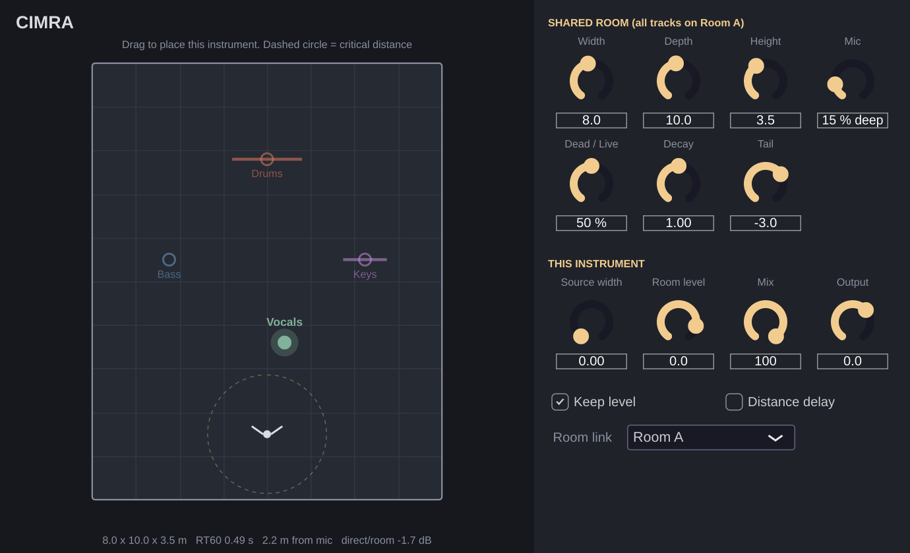

# cimra
cimra je mistnost, *cimra is a room.*

A mixing plugin (VST3 / AU) that puts all your separately recorded tracks into **one virtual room**,
as if the band had played together and been recorded with a single stereo mic pair.



## How to use it

1. Put **Cimra** on every track you want in the room (drums, bass, keys, vocals…).
2. Open any instance and set up the room: size, how live the walls are, where the mics stand.
   Every instance on the same **Room link** (A by default) shares these settings, so change them once.
3. On each track, **drag the instrument** to where it stands. You see the rest of the band as outlines.
4. Mix with your faders as usual. **Keep level** (on by default) holds each track's loudness steady,
   so moving an instrument back only changes how *far away* it sounds, not how loud it is.

Tips:
- The dashed circle is the **critical distance**: inside it an instrument sounds mostly direct and close,
  outside it mostly room. Put the lead vocal inside, drums and pads further back.
- Give stereo sources (drum overheads, keys, guitars recorded in stereo) some **Source width**, so they
  stay wide in the room.
- Want a bit less room on one track? Lower its **Room level**. Want it all, but less of the effect overall?
  Use **Mix**.
- **Distance delay** adds the real time of flight (about 3 ms per metre). It's off by default so everything stays tight.
- Use **Room B/C/D** for a second space, for example a separate vocal booth, or **Off** for a one-off room.

## What it models

| Part | How |
|---|---|
| Mic pair | ORTF: two cardioids 17 cm apart, angled ±55°, so placement turns into real stereo imaging |
| Direct sound | 1/r distance loss, air absorption, mic polar pattern |
| Early reflections | Image-source model of the shoebox room, up to 3rd order (62 reflections per mic), each bounce darker |
| Late reverb | 8-line feedback delay network. RT60 comes from Sabine's formula (room volume and wall absorption), with highs decaying faster |
| Shared room | Every instance computes an identical tail, so the sum of all tracks equals one reverb fed by the whole band |

Room settings sync between instances through shared memory inside the DAW process. DAWs that run each
plugin in its own process (e.g. Bitwig's "per plugin" sandboxing) can't share it. There, set the
same room values on each track by hand (or copy/paste the preset), and the sound will still match.

## Building

Requires CMake 3.22+ and a C++17 compiler. JUCE is downloaded automatically.

```sh
cmake -B build -DCMAKE_BUILD_TYPE=Release
cmake --build build --config Release
ctest --test-dir build -C Release      # DSP tests: timing, RT60, tail level, determinism
```

Plugins land in `build/Cimra_artefacts/Release/` (VST3, AU on macOS, plus a Standalone app).
Copy them to your plugin folder:

- macOS: `~/Library/Audio/Plug-Ins/VST3/` and `~/Library/Audio/Plug-Ins/Components/`
- Windows: `C:\Program Files\Common Files\VST3\`

**Don't want to build?** Every push builds macOS (universal), Windows and Linux binaries with GitHub Actions.
Open the *Actions* tab, pick the latest run and download `Cimra-macOS` or `Cimra-Windows`.
On macOS the build is unsigned, so after copying run
`xattr -dr com.apple.quarantine ~/Library/Audio/Plug-Ins/VST3/Cimra.vst3` (and the same for `Cimra.component`).

## Code map

- `Source/RoomDSP.h`: the room model (image sources, mic pair, FDN reverb), plain C++
- `Source/SharedRoom.h`: process-wide registry that links instances
- `Source/PluginProcessor.*`: parameters, audio routing, level compensation, room sync
- `Source/PluginEditor.*`: top-down room view and controls
- `tests/dsp_test.cpp`: offline tests of the DSP
